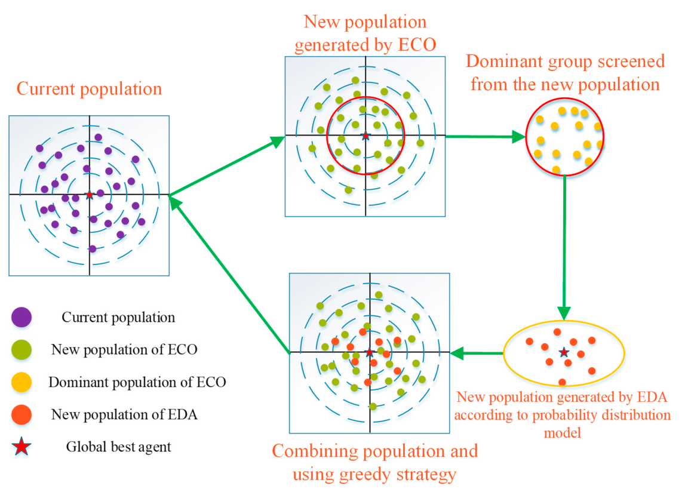
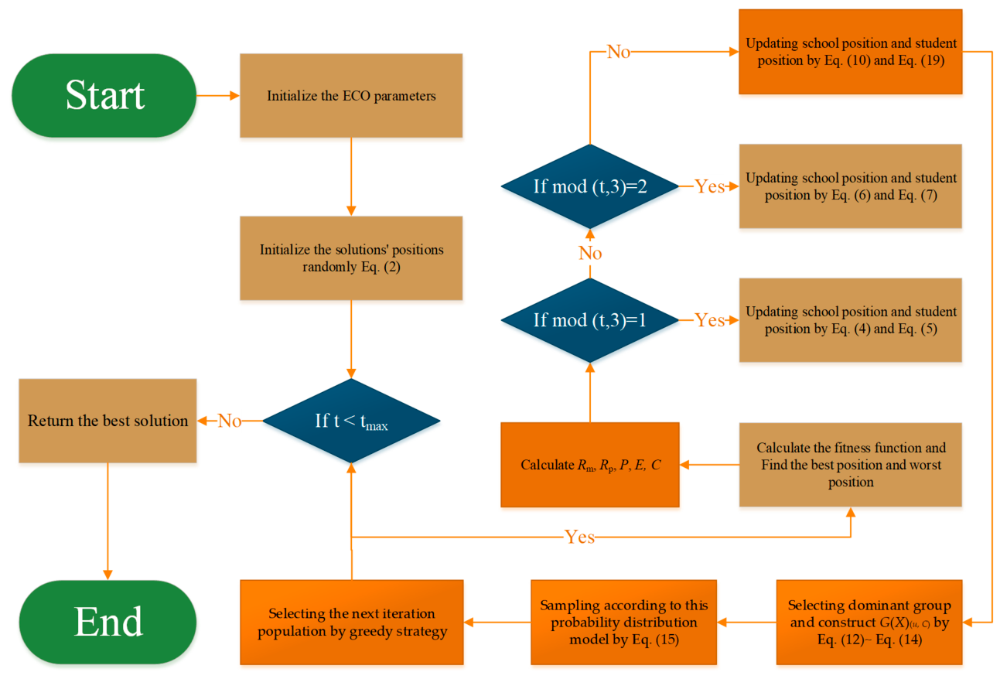
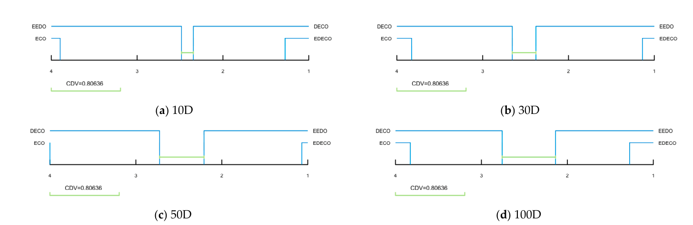
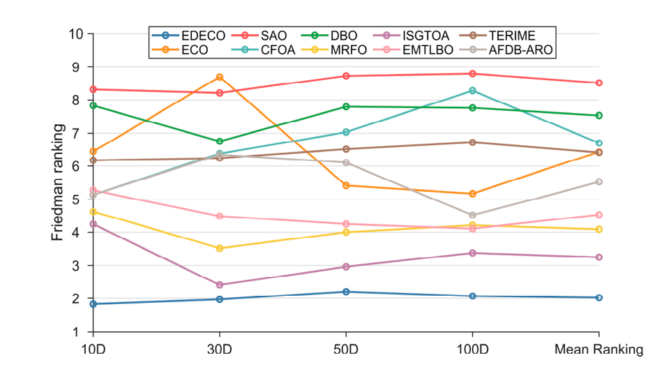
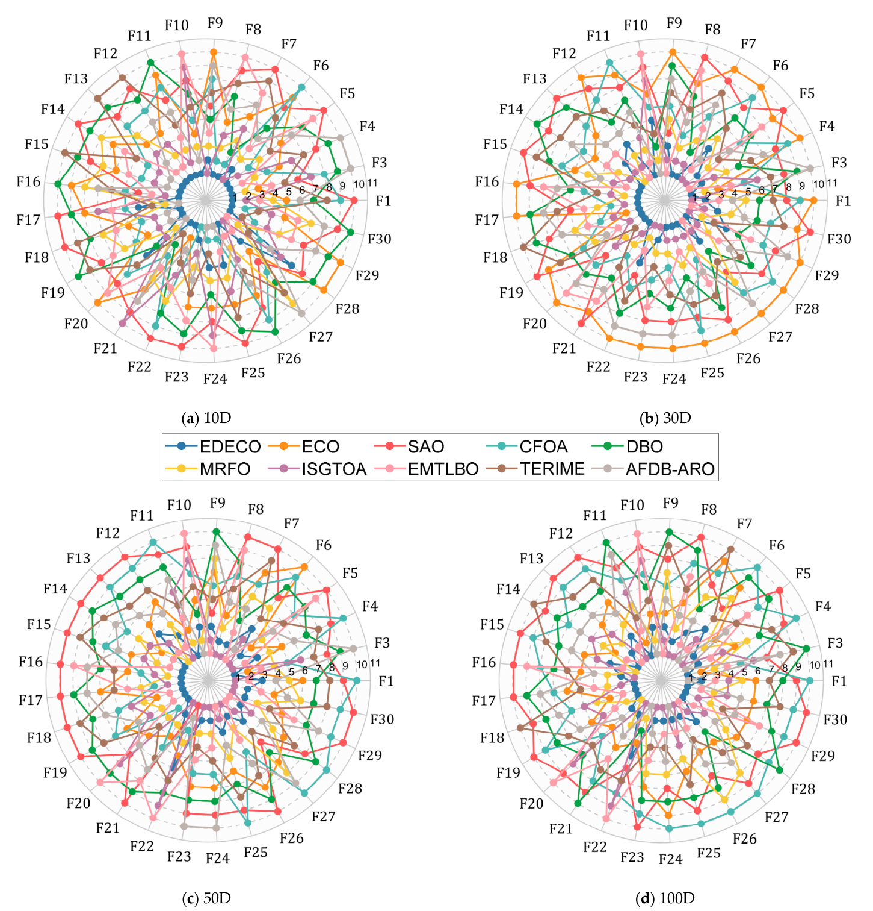
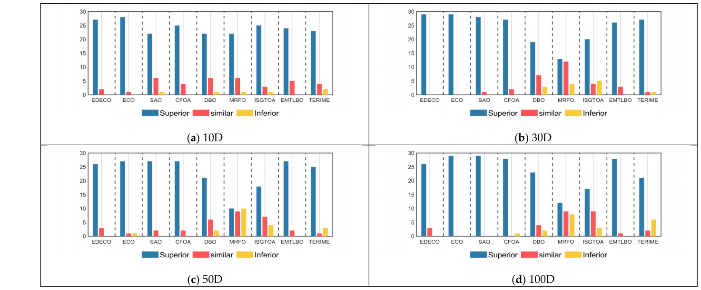
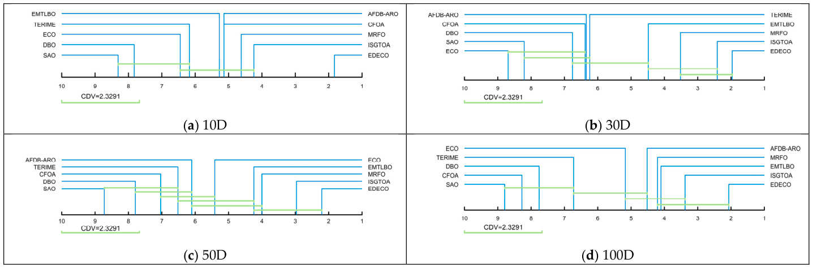
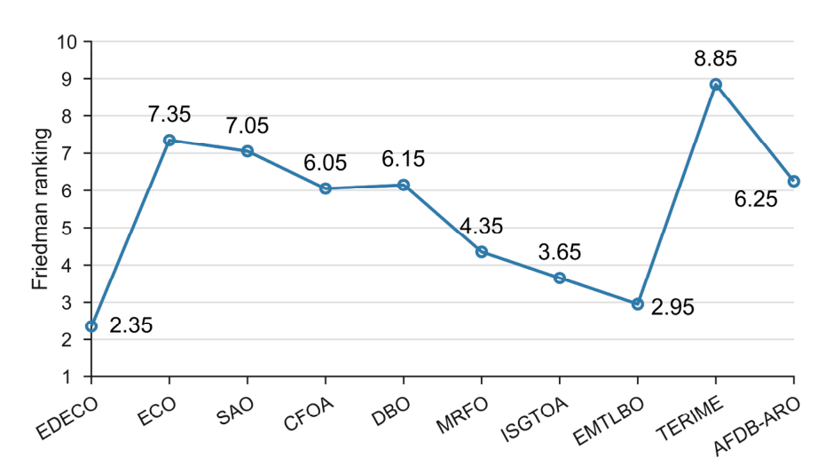

# EDECO: An Enhanced Educational Competition Optimizer

A Python implementation of EDECO, a metaheuristic that enhances the Educational
Competition Optimizer (ECO) with an estimation-of-distribution step and a dynamic
fitness-distance balancing strategy, with the benchmarks, experiment runner, statistics
and plotting code for the ECO / EECO / DECO / EDECO experiments of the paper.

[](https://doi.org/10.3390/biomimetics10030176)
[](pyproject.toml)
[](LICENSE)
[](https://github.com/OdurShi/edeco/actions/workflows/ci.yml)
[](https://github.com/astral-sh/ruff)

> W. Tang, S. Shi, Z. Lu, M. Lin, H. Cheng. **EDECO: An Enhanced Educational Competition
> Optimizer for Numerical Optimization Problems.** *Biomimetics* 2025, 10(3), 176.
> <https://doi.org/10.3390/biomimetics10030176>

The experiments reported in the paper were carried out in MATLAB R2023a. This
repository is a Python (NumPy) implementation of the method written from the paper; the
base ECO follows the reference implementation of its authors. The paper-to-code map and
every implementation choice are documented in
[docs/implementation_notes.md](docs/implementation_notes.md).

## Overview

ECO (Lian et al., 2024) models the competition for school places. The population is
sorted by fitness; the best individuals act as *schools*, the others as *students*.
Iterations cycle through a primary, a middle and a high school stage, each with its own
update rule for schools and for students, and a candidate replaces its parent only if it
is not worse.

EDECO adds two mechanisms:

* **Hybrid search framework (HSF).** After every ECO sweep a Gaussian model is fitted to
  the fittest individuals (the dominant group), new individuals are sampled from it, and
  the next population is selected greedily from the ECO individuals and the samples.
* **Dynamic fitness-distance balancing strategy (DFS).** In the high-school stage the
  students are led by an individual chosen by a score that combines fitness and distance
  to the best solution with a weight that changes during the run.

The ablation variants of the paper, EECO (ECO + HSF) and DECO (ECO + DFS), are switches
of the same implementation.

<p align="center">
  
</p>
<p align="center"><em>Hybrid search framework (Figure 1 of the paper).</em></p>

<p align="center">
  
</p>
<p align="center"><em>Flowchart of EDECO (Figure 2 of the paper).</em></p>

## Installation

Python 3.10 or newer.

```bash
git clone https://github.com/OdurShi/edeco.git
cd edeco

# with uv
uv venv --python 3.11 .venv
uv pip install -p .venv/bin/python -e ".[dev]"

# or with pip
python -m venv .venv && source .venv/bin/activate
pip install -e ".[dev]"
```

The package depends on NumPy, SciPy, PyYAML and Matplotlib; `dev` adds pytest and ruff.
All benchmark data needed by the experiments is part of the repository (see
[Data](#data)).

## Quick start

```bash
edeco demo                      # ECO / EECO / DECO / EDECO on four built-in functions
edeco solve --suite cec2017 --function 5 --dim 10 --algorithm EDECO --seed 0
python examples/quickstart.py   # the library API on a shifted sphere function
```

Output of `edeco demo` (default seed; about 8 s on a laptop CPU):

```text
Mean best value over 5 runs, D = 10, N = 100, 20000 evaluations per run (optimum 0 for every function)
function                       ECO          EECO          DECO         EDECO
shifted_sphere          1.1591e-03    3.6862e-05    1.3962e-01    2.6901e-04
rosenbrock              6.7600e+00    7.5281e+00    7.3630e+00    6.3730e+00
shifted_rastrigin       7.8516e+00    7.6194e+00    1.2417e+01    8.5757e+00
shifted_ackley          1.1547e+00    8.4659e-01    6.4293e-01    4.0432e-01
finished in 7.7 s
```

Library use:

```python
import numpy as np
from edeco import get_config, minimize


def objective(x):  # optimum 0 at (30, ..., 30)
    return float(np.sum((x - 30.0) ** 2))


result = minimize(
    objective,
    bounds=(-100.0, 100.0),
    dim=10,
    pop_size=100,
    max_fes=50_000,
    seed=0,
    config=get_config("EDECO"),
)
print(result.best_f, result.n_evals)
```

`minimize` returns the best solution, its value, the best-so-far history after every
evaluation and the number of evaluations, which always equals `max_fes`. Runs with the
same seed are identical.

## Data

| Data | Used by | Location |
|---|---|---|
| CEC 2017 benchmark definitions (shift vectors, rotation matrices, shuffle permutations) for D = 10, 30, 50, 100 | CEC 2017 experiments (Tables 3-6, A1-A4) | `data/cec2017/cec2017_D<D>.npz` |
| Definitions of the ten engineering design problems RW01-RW10 | engineering experiments (Table 8) | `src/edeco/benchmarks/engineering.py`, summary in `data/engineering/problems.json` |

No download is needed. Sources, licences, file layout and SHA-256 checksums are listed in
[data/README.md](data/README.md). The CEC 2017 functions themselves are implemented in
`src/edeco/benchmarks/cec2017.py` and tested against values of the organisers' C code.
A different data directory can be selected with `--data-dir` (`edeco solve`, `edeco run`)
or the `EDECO_CEC2017_DATA` environment variable.

## Reproducing the paper

Every experiment is described by one YAML file and executed in three steps:

```bash
python scripts/run_experiment.py --config configs/<name>.yaml --output results/<name>
python scripts/make_tables.py  --results results/<name>     # Markdown + CSV tables
python scripts/make_figures.py --results results/<name>     # PNG figures
```

`edeco run | tables | figures` are the equivalent console commands; `--runs`,
`--workers`, `--seed` and `--functions` override the YAML.

| Paper item | Command | Config |
|---|---|---|
| Tables 3-4 (ablation: ECO, EECO, DECO, EDECO) and the ECO / EDECO columns of Table A1, D = 10 | `python scripts/run_experiment.py --config configs/cec2017_10d.yaml --output results/cec2017_10d` | [`configs/cec2017_10d.yaml`](configs/cec2017_10d.yaml) |
| same, D = 30 (Table A2) | `python scripts/run_experiment.py --config configs/cec2017_30d.yaml --output results/cec2017_30d` | [`configs/cec2017_30d.yaml`](configs/cec2017_30d.yaml) |
| same, D = 50 (Table A3) | `python scripts/run_experiment.py --config configs/cec2017_50d.yaml --output results/cec2017_50d` | [`configs/cec2017_50d.yaml`](configs/cec2017_50d.yaml) |
| same, D = 100 (Table A4) | `python scripts/run_experiment.py --config configs/cec2017_100d.yaml --output results/cec2017_100d` | [`configs/cec2017_100d.yaml`](configs/cec2017_100d.yaml) |
| Table 8 (engineering problems; ECO and EDECO columns) | `python scripts/run_experiment.py --config configs/engineering.yaml --output results/engineering` | [`configs/engineering.yaml`](configs/engineering.yaml) |

`make_tables.py` writes `summary` (layout of Tables A1-A4), `friedman` (Tables 3 and 6),
`rank_sum_vs_baseline` (Table 4), `rank_sum` (Table 5) and, for the engineering suite,
`engineering` (Table 8); `make_figures.py` writes convergence curves, box plots, the
Friedman ranking with the Nemenyi critical difference and the rank-sum counts.

Protocol of the paper (Section 4.1): 29 CEC 2017 functions in 10, 30, 50 and 100
dimensions, `Fes_max = 5000 * D` function evaluations per run, 30 independent runs,
Wilcoxon rank-sum test at the 0.05 level and Friedman test; MATLAB R2023a on an AMD R9
7940HX with 32 GB of RAM. Parameter values follow Table 2 (`H = 0.5`, `G1 = 0.2`,
`G2 = 0.1`, `alpha = 10`, `beta = 0.4`); the remaining settings of each configuration
are in its YAML file and are discussed in the implementation notes. The repository
covers ECO and its three variants; the eight comparison algorithms of Section 4.3 (SAO,
CFOA, DBO, MRFO, ISGTOA, EMTLBO, TERIME, AFDB-ARO) are described in their own
publications.

`configs/reduced_cec2017_10d_eq11.yaml` and `configs/reduced_engineering.yaml` are 10-run
versions of the first and the last row; `configs/reduced_cec2017_10d_eq19.yaml` and
`configs/sensitivity_10d.yaml` vary individual settings. Example outputs of these
configurations are in [`results/reduced/`](results/reduced/).

## Method-to-code map

| Paper | What | Code |
|---|---|---|
| Eq. (1)-(2) | logistic-map initialisation | `src/edeco/operators.py:logistic_map_init` |
| Eq. (3), (8), (9) | step weight `w`, amplitude `P`, talent coefficient `E` | `operators.py:step_weight`, `amplitude`, `talent_product` |
| Eq. (4)-(5) | primary school stage | `operators.py:primary_school_update`, `primary_student_update` |
| Eq. (6)-(7) | middle school stage | `operators.py:middle_school_update`, `middle_student_update` |
| Eq. (10)-(11) | high school stage | `operators.py:high_school_update`, `high_student_update` |
| `close(.)`, `Levy(D)` | nearest school, Lévy step | `operators.py:nearest_school`, `levy_step` |
| Eq. (12)-(15) | Gaussian model of the dominant group and sampling | `src/edeco/eda.py:fit_gaussian`, `GaussianModel.sample` |
| Fig. 1 | dominant group, greedy selection | `eda.py:select_dominant`, `truncate_union` |
| Eq. (16)-(18) | DFS score and weight | `src/edeco/dfs.py:dfs_scores`, `select_dfs`, `dfs_weight` |
| Eq. (19) | high school students led by `X_DFS` | `operators.py:high_student_update` with `X_DFS` as leader (default), `dfs_student_update` (equation as printed) |
| Algorithms 1-2, Fig. 2 | ECO / EDECO main loop, ablation switches | `src/edeco/optimizer.py:minimize`, `ECOConfig`, `ALGORITHMS` |
| Table 1 | CEC 2017 functions F1, F3-F30 | `src/edeco/benchmarks/cec2017.py` |
| Table 2 | parameter values | defaults of `optimizer.py:ECOConfig` |
| Table 7 | engineering design problems RW01-RW10 | `src/edeco/benchmarks/engineering.py` |
| Sec. 4.1 | budget `5000 * D`, independent runs | `src/edeco/experiments/`, `configs/` |
| Tables 3-6, Eq. (20) | Friedman test, Wilcoxon rank-sum test, Nemenyi critical difference | `src/edeco/analysis/stats.py`, `tables.py` |
| Tables A1-A4, 8 | best / mean / std tables | `src/edeco/analysis/tables.py` |

The full map, the choices made where the paper leaves a detail open, and the record of
the runs carried out with this code are in
[docs/implementation_notes.md](docs/implementation_notes.md).

## Results

All tables and figures in this section are taken from the paper.

**Ablation study.** Results from the paper (Table 3): Friedman mean ranks of ECO, the two
single-strategy variants and EDECO on the 29 CEC 2017 functions.

| Dimension | ECO | EECO | DECO | EDECO | p-value |
|---|---|---|---|---|---|
| 10 | 3.90 | 2.48 | 2.34 | 1.28 | 4.75E-13 |
| 30 | 3.83 | 2.38 | 2.66 | 1.14 | 9.89E-14 |
| 50 | 4.00 | 2.21 | 2.72 | 1.07 | 1.25E-16 |
| 100 | 3.83 | 2.14 | 2.76 | 1.28 | 5.36E-13 |
| Mean ranking | 3.89 | 2.30 | 2.62 | 1.19 | |

Results from the paper (Table 4): Wilcoxon rank-sum test against ECO at the 0.05 level;
`+/=/-` is the number of functions on which the variant is significantly better, not
significantly different, or significantly worse.

| vs. ECO | 10D | 30D | 50D | 100D |
|---|---|---|---|---|
| EECO | 22/6/1 | 19/10/0 | 20/9/0 | 21/8/0 |
| DECO | 21/7/1 | 15/12/2 | 17/12/0 | 19/10/0 |
| EDECO | 28/1/0 | 27/2/0 | 27/2/0 | 26/3/0 |

<p align="center">
  
</p>
<p align="center"><em>Multiple comparisons of ECO, EDECO and its two variants using the critical difference value (Figure 3 of the paper).</em></p>

**Comparison with other algorithms.** Results from the paper (Table 6): Friedman mean
ranks of EDECO, ECO and eight other algorithms on the CEC 2017 suite.

| Algorithm | 10D | 30D | 50D | 100D | Mean ranking | Overall ranking |
|---|---|---|---|---|---|---|
| EDECO | 1.8276 | 1.9655 | 2.2069 | 2.0690 | 2.0172 | 1 |
| ECO | 6.4483 | 8.6897 | 5.4138 | 5.1724 | 6.4310 | 7 |
| SAO | 8.3103 | 8.2069 | 8.7241 | 8.7931 | 8.5086 | 10 |
| CFOA | 5.1379 | 6.3793 | 7.0345 | 8.2759 | 6.7069 | 8 |
| DBO | 7.8276 | 6.7586 | 7.7931 | 7.7586 | 7.5345 | 9 |
| MRFO | 4.6207 | 3.5172 | 4.0000 | 4.2069 | 4.0862 | 3 |
| ISGTOA | 4.2414 | 2.4138 | 2.9655 | 3.3793 | 3.2500 | 2 |
| EMTLBO | 5.2759 | 4.4828 | 4.2414 | 4.1034 | 4.5259 | 4 |
| TERIME | 6.1724 | 6.2414 | 6.5172 | 6.7241 | 6.4138 | 6 |
| AFDB-ARO | 5.1379 | 6.3448 | 6.1034 | 4.5172 | 5.5259 | 5 |
| p-value | 5.00E-17 | 3.11E-28 | 2.81E-23 | 6.25E-27 | | |

<p align="center">
  
</p>
<p align="center"><em>Friedman test results of EDECO and its competitors (Figure 6 of the paper).</em></p>

Results from the paper (Table 5): Wilcoxon rank-sum test of EDECO against each
competitor (`+/=/-` = EDECO significantly better / similar / worse).

| EDECO vs. | 10D | 30D | 50D | 100D | Total |
|---|---|---|---|---|---|
| ECO | 27/2/0 | 29/0/0 | 26/3/0 | 26/3/0 | 108/8/0 |
| SAO | 28/1/0 | 29/0/0 | 27/1/1 | 29/0/0 | 113/2/1 |
| CFOA | 22/6/1 | 28/1/0 | 27/2/0 | 29/0/0 | 106/9/1 |
| DBO | 25/4/0 | 27/2/0 | 27/2/0 | 28/0/1 | 107/8/1 |
| MRFO | 22/6/1 | 19/7/3 | 21/6/2 | 23/4/2 | 85/23/8 |
| ISGTOA | 22/6/1 | 13/12/4 | 10/9/10 | 12/9/8 | 57/36/23 |
| EMTLBO | 25/3/1 | 20/4/5 | 18/7/4 | 17/9/3 | 80/23/13 |
| TERIME | 24/5/0 | 26/3/0 | 27/2/0 | 28/1/0 | 105/11/0 |
| AFDB-ARO | 23/4/2 | 27/1/1 | 25/1/3 | 21/2/6 | 96/8/12 |

<details>
<summary>Figures 4, 5 and 7 of the paper (per-function rankings, rank-sum counts, critical-difference comparison)</summary>

<p align="center">
  
</p>
<p align="center"><em>Rankings based on the average result on each benchmark function (Figure 4 of the paper).</em></p>

<p align="center">
  
</p>
<p align="center"><em>Wilcoxon rank-sum test results between EDECO and its competitors (Figure 5 of the paper).</em></p>

<p align="center">
  
</p>
<p align="center"><em>Multiple comparisons of EDECO and its competitors using the critical difference value (Figure 7 of the paper).</em></p>

</details>

**Engineering design problems.** Results from the paper (Table 8, last rows): Friedman
ranking over the ten constrained engineering problems and Wilcoxon rank-sum counts of
EDECO against each competitor.

| | EDECO | ECO | SAO | CFOA | DBO | MRFO | ISGTOA | EMTLBO | TERIME | AFDB-ARO |
|---|---|---|---|---|---|---|---|---|---|---|
| Friedman ranking | 2.35 | 7.35 | 7.05 | 6.05 | 6.15 | 4.35 | 3.65 | 2.95 | 8.85 | 6.25 |
| Wilcoxon rank sum (EDECO vs.) | | 9/1/0 | 9/1/0 | 8/2/0 | 7/3/0 | 7/1/2 | 8/1/1 | 6/4/0 | 9/1/0 | 8/1/1 |

<p align="center">
  
</p>
<p align="center"><em>Friedman ranking of EDECO and its competitors on the constrained engineering problems (Figure 8 of the paper).</em></p>

The per-function results of the paper (best, mean and standard deviation for every
function and dimension) are in its Tables A1-A4 and Table 8.

## Repository structure

```
README.md                     this file
LICENSE                       MIT
CITATION.cff                  citation metadata of the article
pyproject.toml                package metadata, optional dependencies, ruff and pytest settings
src/edeco/
  optimizer.py                ECO / EECO / DECO / EDECO main loop, ECOConfig, minimize()
  operators.py                update rules of the three school stages (Eq. 1-11, 19)
  eda.py                      Gaussian model, sampling and greedy selection (Eq. 12-15)
  dfs.py                      dynamic fitness-distance balancing (Eq. 16-18)
  evaluator.py                evaluation budget, best-so-far tracking, history
  benchmarks/                 classical functions, CEC 2017, engineering problems
  experiments/                YAML configuration and parallel experiment runner
  analysis/                   statistics, tables and figures
  cli.py                      edeco demo | solve | run | tables | figures
configs/                      one YAML file per experiment
scripts/                      run_experiment.py, make_tables.py, make_figures.py and
                              maintenance tools for the data and the paper figures
examples/quickstart.py        minimal library example
data/                         CEC 2017 definition data, engineering problem definitions
assets/paper_figures/         Figures 1-8 of the paper
tests/                        unit tests of every operator, benchmarks, statistics, end-to-end
docs/implementation_notes.md  paper-to-code map, implementation choices, record of runs
results/reduced/              example outputs of the reduced-scale configurations
.github/workflows/ci.yml      ruff + pytest on Python 3.10 and 3.12
```

## Citation

```bibtex
@article{tang2025edeco,
  title   = {{EDECO}: An Enhanced Educational Competition Optimizer for Numerical Optimization Problems},
  author  = {Tang, Wenkai and Shi, Shangqing and Lu, Zengtong and Lin, Mengying and Cheng, Hao},
  journal = {Biomimetics},
  volume  = {10},
  number  = {3},
  pages   = {176},
  year    = {2025},
  doi     = {10.3390/biomimetics10030176}
}
```

## License

The code in this repository is released under the [MIT License](LICENSE). The article
and its figures in `assets/paper_figures/` are open access under CC BY 4.0. The licences
of the shipped data are listed in [data/README.md](data/README.md).

## Acknowledgements

* **Educational Competition Optimizer.** J. Lian, T. Zhu, L. Ma, X. Wu, A. A. Heidari,
  Y. Chen, H. Chen, G. Hui, "The Educational Competition Optimizer", *International
  Journal of Systems Science* 55 (2024) 3185-3222; reference MATLAB code at
  <https://github.com/junbolian/ECO>. The base algorithm was re-implemented in Python;
  no source file of that project is included.
* **CEC 2017 test suite.** N. H. Awad, M. Z. Ali, J. J. Liang, B. Y. Qu, P. N. Suganthan,
  "Problem Definitions and Evaluation Criteria for the CEC 2017 Special Session and
  Competition on Single Objective Real-Parameter Numerical Optimization", Technical
  Report, Nanyang Technological University, 2016.
* **Fitness-distance balance.** The weight schedule of the DFS strategy is implemented
  after the dynamic fitness-distance balance method of H. T. Kahraman, H. Bakir,
  S. Duman, M. Katı, S. Aras, U. Guvenc, "Dynamic FDB selection method and its
  application: modeling and optimizing of directional overcurrent relays coordination",
  *Applied Intelligence* 52 (2022) 4873-4908.
* **Engineering design problems.** Formulations follow the sources cited in
  `src/edeco/benchmarks/engineering.py`, in particular A. Kumar, G. Wu, M. Z. Ali,
  R. Mallipeddi, P. N. Suganthan, S. Das, "A test-suite of non-convex constrained
  optimization problems from the real-world and some baseline results", *Swarm and
  Evolutionary Computation* 56 (2020) 100693.
* NumPy, SciPy, Matplotlib and PyYAML.
